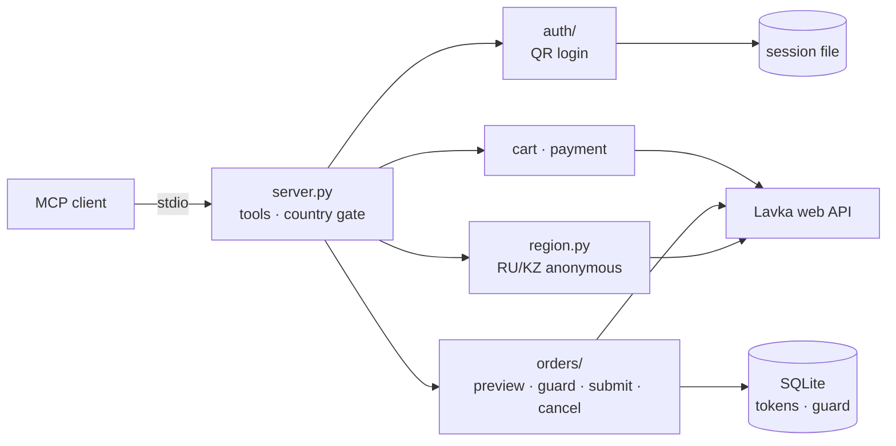

<h1 align="center">Better Lavka MCP 🛒</h1>

<p align="center">
  <strong>Groceries from Yandex Lavka Uzbekistan, ordered by your AI assistant.</strong>
</p>

<p align="center">
  <a href="docs/auth.md">Sign in</a> ·
  <a href="docs/checkout.md">Checkout</a> ·
  <a href="docs/clients.md">Clients</a> ·
  <a href="SECURITY.md">Security</a> ·
  <a href="CONTRIBUTING.md">Contributing</a> ·
  <a href="LICENSE">GPL-3.0</a>
</p>

---

## What is this, really?

A local **stdio MCP server** that talks to the same undocumented web API as `lavka.yandex.uz`. Connect it to Claude, Codex, OpenCode or any MCP client, and the assistant can search the shelves, fill your cart and place a real order on your real account.

No browser automation, no cookie copy-paste: you sign in by scanning a QR code with the Yandex app. State lives in a private directory on your machine, nowhere else.

---

## Stuff you do with it

- **Ask what's on the shelf.** «Chilonzorda sut bormi?» — milk and its price at the nearest Lavka.
- **Build the cart by talking.** «Добавь два кефира и хлеб» — done, and the assistant tells you the new total.
- **Order in one sentence.** "Order it home, card ending 4242" — the assistant shows the address, items and total.
- **Say yes.** The order goes out.
- **Check on orders.** «Покажи прошлые заказы», «отмени заказ».
- **Peek at Russia and Kazakhstan.** Browse the RU and KZ storefronts and search their products.

---

## Three little stories

**Sunday restock.** You type *«закажи молоко, яйца и хлеб домой, картой 4242»*. The assistant finds them, fills the cart, shows you the total. You say «да», and breakfast is on its way.

**Recipe to cart.** You paste a plov recipe and say *«собери всё для этого на четверых»*. Rice, carrots, lamb, oil and cumin land in the cart in the right amounts. Anything out of stock, the assistant tells you and offers a swap.

**Same again.** *«Oxirgi buyurtmalarimni ko‘rsat»* The assistant lists your recent orders and answers in Uzbek, because that's how you asked.

---

## Works today · Not yet

| ✅ Works today | 🚧 Not yet |
|---|---|
| Sign in with a QR code from the Yandex app | 3-D Secure confirmation inside the chat |
| Product and address search, cart editing | Scheduled delivery slots |
| Saved addresses and cards, order history | Live order tracking |
| Order to a saved address with a chosen card, cancel an order | |
| Browse the RU and KZ storefronts | Ordering in Russia and Kazakhstan |

---

## Getting started

You need [mise](https://mise.jdx.dev/getting-started.html) and a Unix-like system.

**Once:**
```sh
git clone https://github.com/d3d0n/better-lavka-mcp.git && cd better-lavka-mcp
mise trust && mise install
mise run install   # Python 3.12 + deps from uv.lock
mise run test      # offline suite, no network, no money
```

**Then plug it into your client:**
```json
{
  "mcpServers": {
    "lavka": {
      "type": "stdio",
      "command": "/absolute/path/to/better-lavka-mcp/.venv/bin/better-lavka-mcp"
    }
  }
}
```

Ask the assistant to call `start_login`, scan the QR in the Yandex app, and you're in. Per-client examples (Claude Code, Claude Desktop, OpenCode, Oh My Pi) are in [docs/clients.md](docs/clients.md).

Settings:

- `YANDEX_LAVKA_REGION` — startup country: `UZ` (default), `RU` or `KZ`. `select_country` changes it for this process only.
- `YANDEX_SESSION_FILE` — where the session cookies live.

---

## Tools

Twenty tools with plain verb + noun names, so the assistant picks the right one on the first try.

| Tool | What it does |
|---|---|
| `search_products` | Find products and prices |
| `get_cart` | What's in the cart and the total |
| `set_cart_quantity` | Add, change or remove an item |
| `list_saved_addresses` | Your saved addresses |
| `list_saved_cards` | Your saved cards |
| `preview_order` | Address, card, items and total before ordering |
| `submit_order` | Place the order |
| `cancel_order` | Cancel an order |
| `list_active_orders` | Whether any orders are currently tracked |
| `list_order_history` | Past orders |
| `start_login` · `get_login_status` · `cancel_login` | Sign in with a QR code |
| `search_addresses` | Find an address by text |
| `get_saved_address_coordinates` · `check_coordinates` | Turn an address into a delivery point |
| `count_saved_addresses` | How many addresses are saved |
| `get_storefront_status` | Is Lavka open, delivery time |
| `select_country` | Switch between UZ, RU and KZ |
| `reconcile_order_attempt` | Unblock ordering after a dropped connection |

---

## Under the hood



Session and order state live under `~/.local/share/yandex-lavka-mcp/`.

<details>
<summary><strong>Code map</strong></summary>

`src/better_lavka_mcp/`

- `server.py` — the tools
- `auth/` — QR sign-in
- `cart.py`, `payment.py`, `region.py` — cart, saved cards, RU/KZ storefronts
- `orders/` — preview, submit, cancel, tracking
- `constants.py`, `errors.py` — shared bits

</details>

---

## What it is not

- Not official. Not affiliated with or endorsed by Yandex. The API is undocumented and may change.
- Not a payment processor. It never sees full card numbers.

---

<p align="center">
  <sub>Unofficial · runs on your machine · <a href="LICENSE">GPL-3.0-only</a></sub>
</p>
